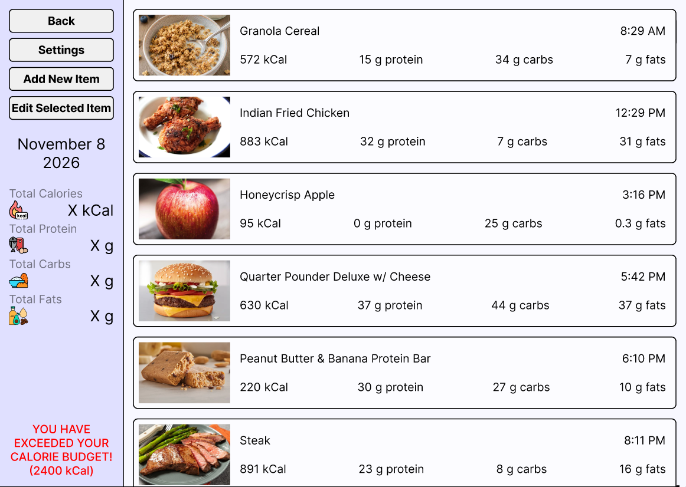
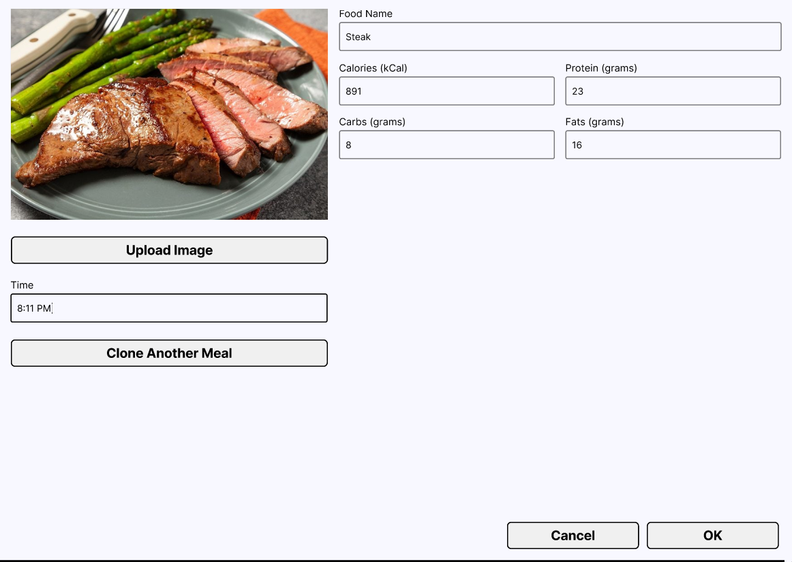
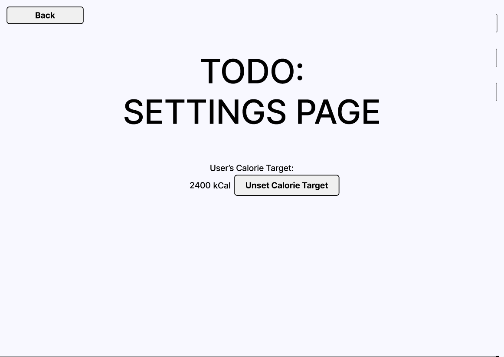

# User Story 3 UI Plans

**Designer**: Bradley Goralczyk

**Tester**: Jakub Niedzielski

**Figma Link**: https://www.figma.com/design/Sj6rAJbA8swr6eaFbDbiXi/3.1-Project---ECE-354?node-id=1-2695

## User Story

As a bodybuilder following a cutting or bulking plan, I want a warning when my logged calories are more than 20% off my daily target so that I can correct course for future days. 

## Acceptance Criterion

Given my daily calorie target is 2,000 kcal, when my logged total for the day reaches 2,401 kcal, then a warning is displayed (and none is displayed at exactly 2,400 kcal).

## Screen 1 - Food Tracker Menu With List

Shows today's meals with names, timestamps, calories, protein, carbohydrates, and fats.  New items can be added, and a warning message appears on the botton left when the total calories exceeds the user's calorie target by over 20%.

## Screen 2 - Food Tracker Submenu Add New Item

Accepts user data for and photograph of a new meal.  An existing meal can be cloned (TODO).

## Screen 3 - Placeholder Settings Page

A placeholder screen where the user's calorie target can be unset (set to the sentinel value 0).  This will be relocated to a proper settings page in the future (TODO).

